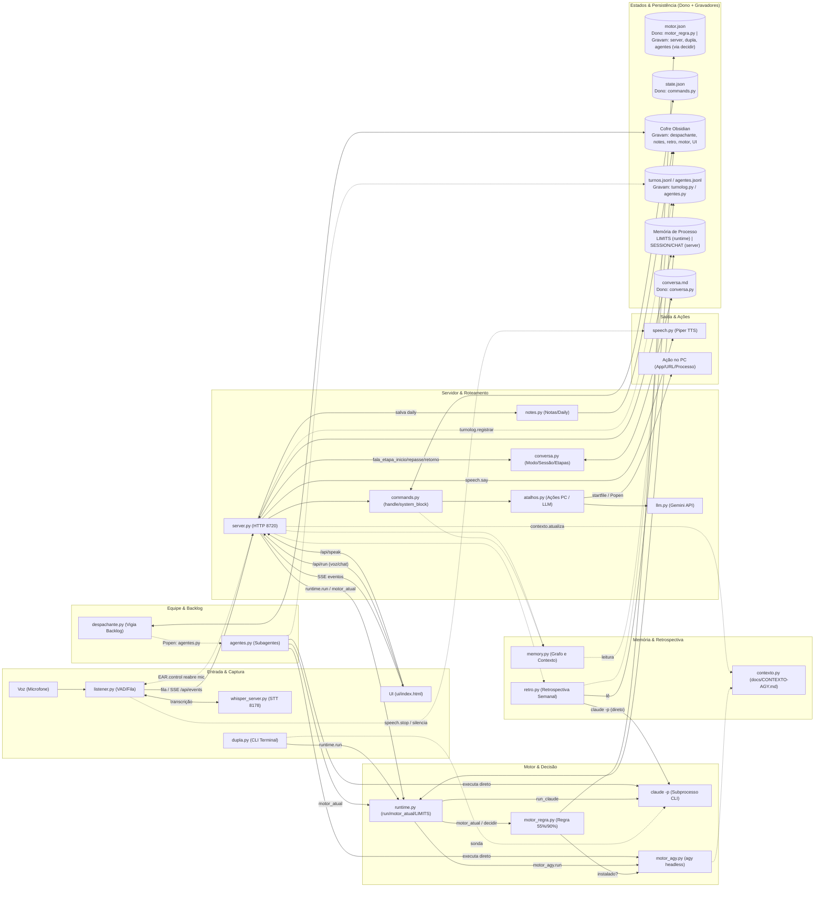
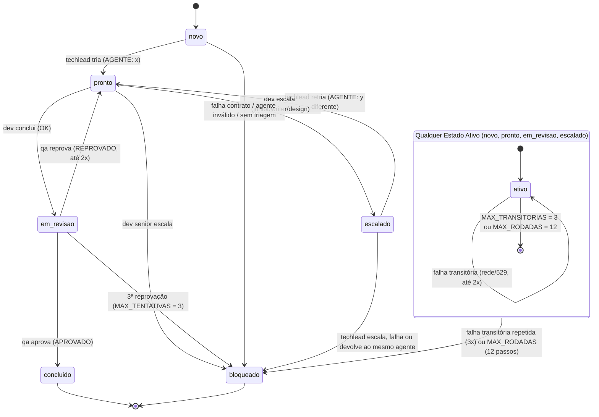

# Diagrama do Sistema — Fedora Assistente

Visão concisa e objetiva da arquitetura atual do sistema Fedora (Windows 11, local, híbrido Claude/Antigravity).

## 1. Fluxo Principal do Sistema

---

## 2. Ciclo de Vida de um Card no Backlog

Gerenciado por `despachante.py` vigiando `backlog/<projeto>/[<grupo>/]<NNNN>-<slug>.md` no cofre Obsidian (usuário pode alterar o status manualmente):

> **Nota:** os estados `aguardando_arquiteto` e `para_decisao` existem no backlog para controle manual/revisão, mas o `despachante.py` os ignora de propósito (não estão em `QUEM_RODA`).

---

## 3. Legenda e Pontos de Acoplamento

### Legenda
- **Entrada & Ingresso**: captura de áudio com VAD/Whisper (`listener.py`, `whisper_server.py`), UI web intermediadora (`ui/index.html`), CLI terminal (`dupla.py`) e endpoints HTTP 8720 (`server.py`).
- **Roteamento & Contexto**: comandos locais (`commands.py`), atalhos com fallback LLM (`atalhos.py`, `llm.py`), etapas de fala (`conversa.py`), notas Obsidian (`notes.py`) e memória (`memory.py`).
- **Motor & Decisão**: Claude e `agy` via `runtime.py` e `motor_regra.py` (limites 55%/90% em `motor.json` e `runtime.LIMITS` em memória).
- **Equipe & Backlog**: subagentes de `agentes.py` disparados por subprocesso/shell pelo `despachante.py` ou motor, chamando CLIs diretamente.
- **Saída & Estados**: síntese Piper (`speech.py`), interface web e arquivos/estruturas de estado com múltiplos gravadores sem trava global.

### Pontos de Acoplamento ou Risco
1. **Resiliência de Decisão de Motor (`motor_regra.py` e `motor.json`)**: se `motor.json` estiver corrompido, é lido como vazio e cai no Claude por padrão sem travar o sistema; falhas de gravação são ignoradas silenciosamente.
2. **Execução de CLIs Externos Headless (`claude -p` e `agy`)**: o motor principal roda com permissão ampla no `runtime.py`/`motor_agy.py`, enquanto os subagentes em `agentes.py` rodam isolados com ferramentas restritas e lista estreita de comandos.
3. **Acoplamento de Contrato de Linha no Backlog**: resposta sem a linha do contrato ou formato inesperado vira FALHA e é bloqueada pelo `despachante.py`.
4. **Disputa e Concorrência em `motor.json`**: servidor, `dupla.py` e `agentes.py` (lançado pelo despachante) realizam leitura-modificação-escrita concorrente sem trava de arquivo entre processos.
5. **Gargalo de Transcrição e Concorrência na Voz**: `listener.py` depende de `whisper_server.py` ativo na porta 8178; novas capturas de comando de voz são bloqueadas durante o `RUN_LOCK` do servidor, embora o ditado continue passando.
6. **UI como Ponto Único de Falha da Voz**: o fluxo de áudio depende da UI aberta para receber eventos SSE de `listener.py` e disparar o `POST /api/run` e `/api/speak`.
7. **Hub de Acoplamento em `runtime.py`**: centraliza dependências de `server`, `agentes`, `dupla`, `retro` e `despachante`, com ciclos de import tardio entre `runtime`, `motor_regra` e `motor_agy`.
8. **Múltiplos Gravadores no Cofre Obsidian sem Coordenação Comum**: despachante, `notes.py`, `retro.py`, Obsidian/usuário e o motor via comandos gravam independentemente no cofre.
